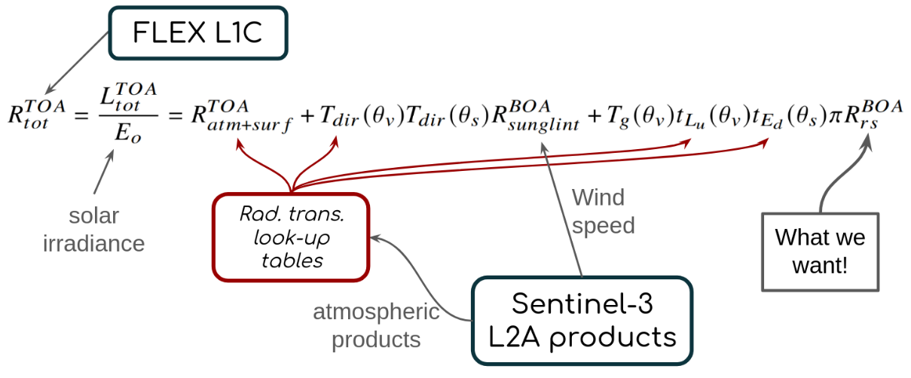
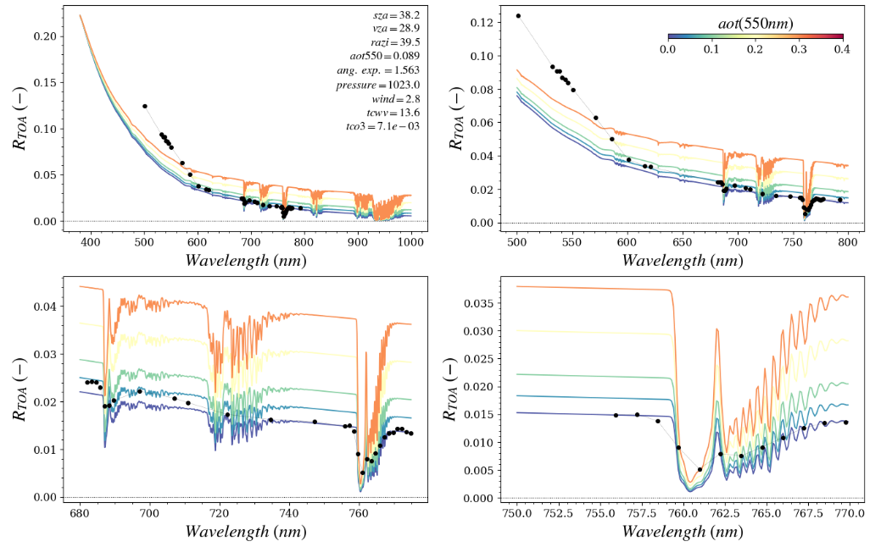

# RS3FLEX_ACaqua package
## Prototype code to perform atmospheric correction of FLEX above water

### Principles





### Installation
First install this package:
https://github.com/Tristanovsk/radcalnet_oc
For this package it is necessary to download the look-up table (LUT) file [here](https://drive.google.com/drive/folders/1r3unjh8UYTvO87nbppqivVq_cwbVxhLk?usp=drive_link)  and set their path in radcalnet-oc/config.yml


And then, in the repertory of your clone type:
```commandline
pip install .
```


